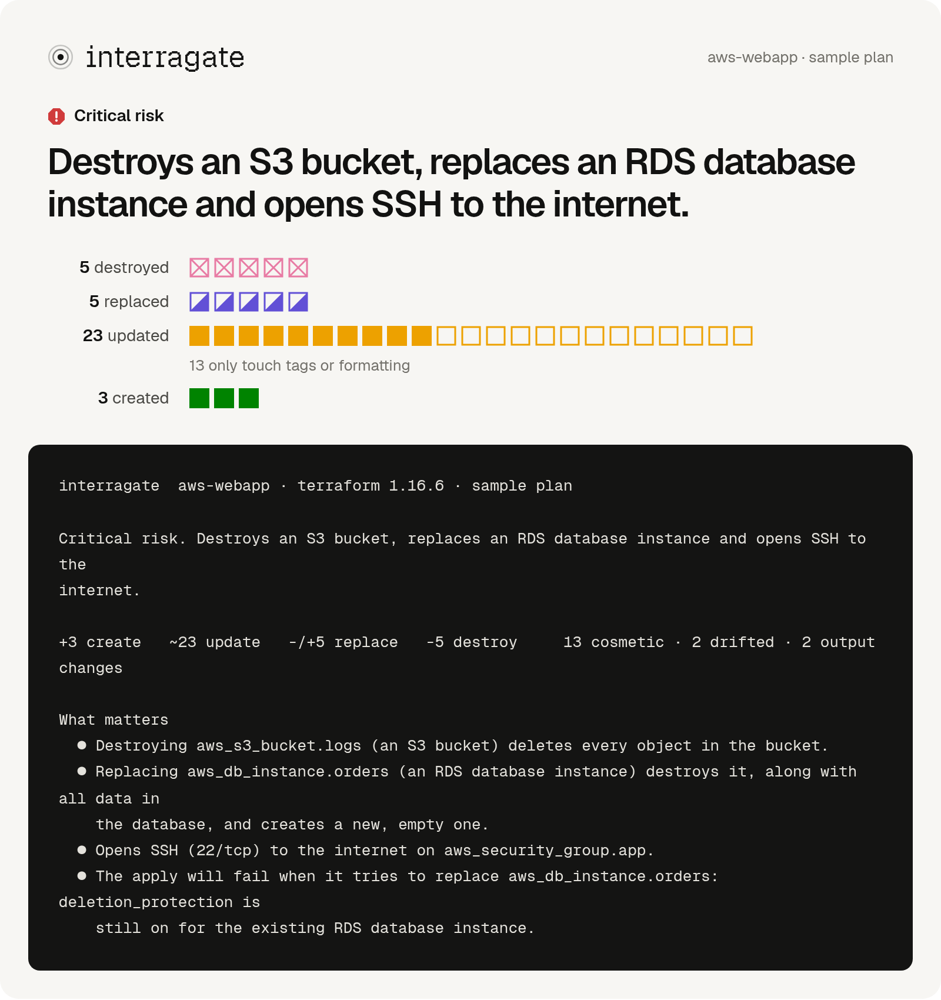
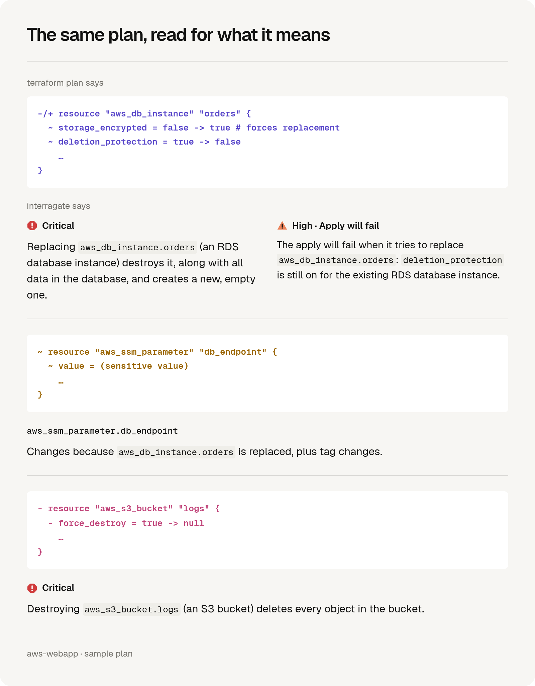
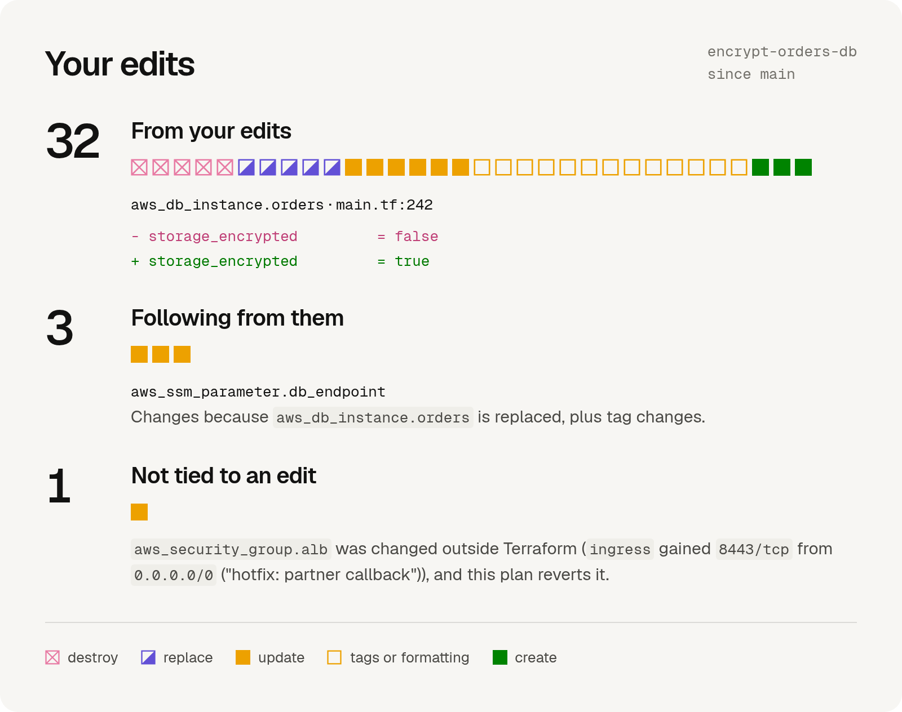
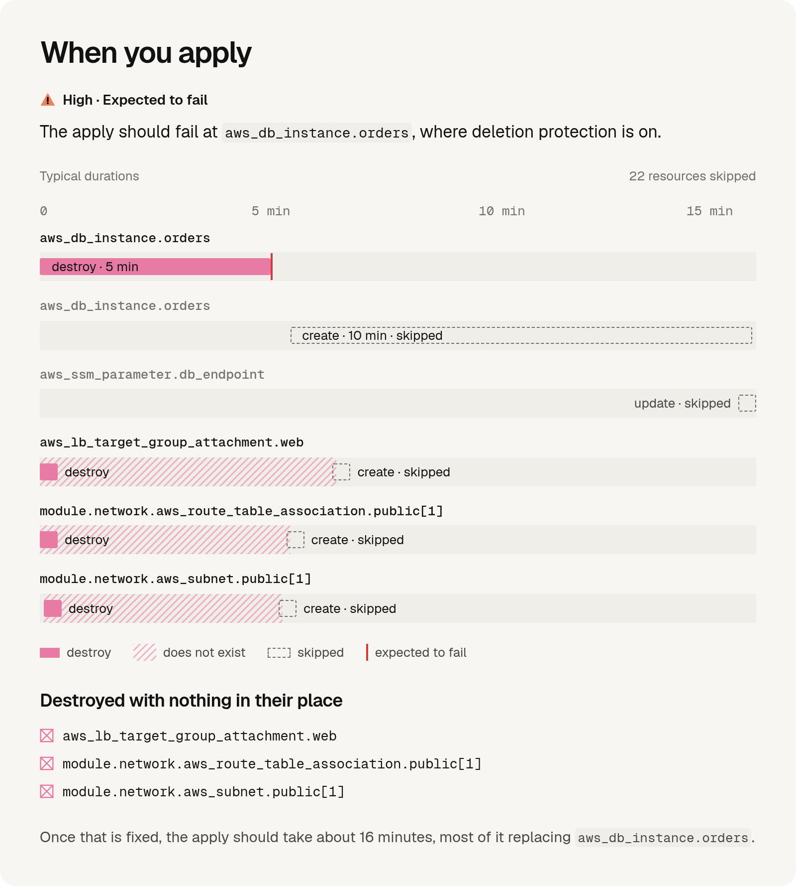
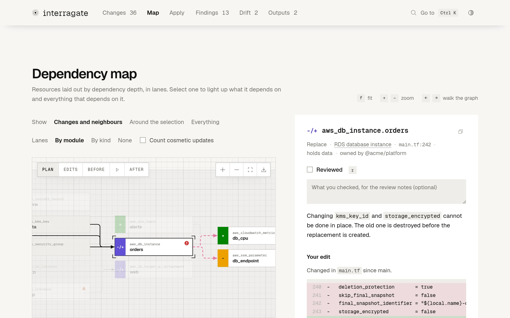
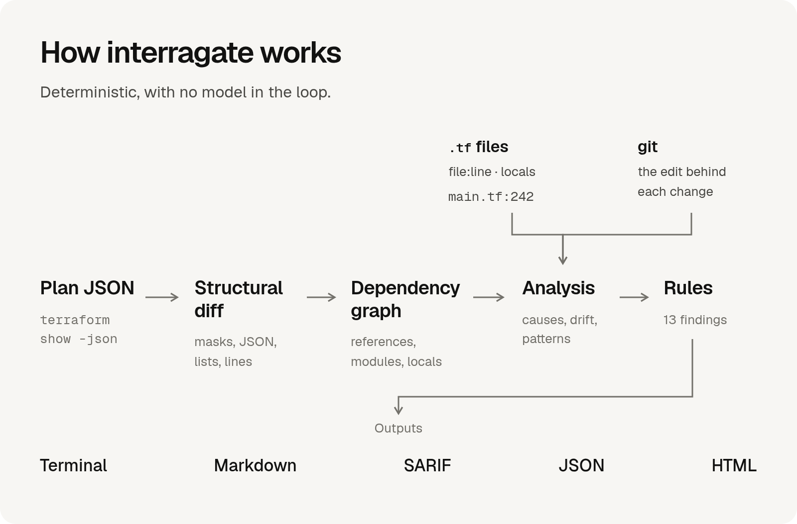

# interragate

**Understand a Terraform or OpenTofu plan before you apply it.**

`terraform plan` tells you *what* will change. interragate tells you what that *means*: which changes destroy data, which only happen because something else changed, what was changed by hand and is about to be undone, and where the apply will fail. It runs locally on the `terraform` or `tofu` you already use, with no account, and nothing leaves your machine.

**Early release:** analysis is heuristic, with the most detailed rules for AWS. Review the underlying plan before applying. [Report a bug](https://github.com/Jeecabs/interragate/issues) or [contribute](CONTRIBUTING.md).

<picture>
  <source media="(prefers-color-scheme: dark)" srcset="docs/images/explain-hero-dark.png">
  
</picture>

## Quick start

```sh
go install github.com/Jeecabs/interragate/cmd/interragate@latest
interragate demo          # a sample plan: no Terraform or cloud account needed
```

Then, in a Terraform or OpenTofu directory:

```sh
interragate               # plan and explain
interragate --open        # ...and open the interactive report
interragate watch         # a live report that plans again every time you save
interragate apply         # apply exactly the plan you just read, once you confirm
```

Already have a plan? `interragate show tfplan` explains a plan file or plan JSON. Every command, other ways to install and tab completion: [docs/commands.md](docs/commands.md).

## What it tells you

<picture>
  <source media="(prefers-color-scheme: dark)" srcset="docs/images/explain-meaning-dark.png">
  
</picture>

- **Why each resource changes**, with Terraform's reasons spelled out.
- **What a change follows from**: values are traced through references, modules and locals, so twenty ripples read as one cause.
- **What it costs**: data destroyed, the window a replaced resource is gone, access opened ("+ Inbound TCP 22 (SSH) from `0.0.0.0/0`").
- **What only looks like a change**: tag-only updates, null-versus-empty flips and reformatted JSON are folded away.

More, with drift, deploys and readable diffs: [docs/analysis.md](docs/analysis.md).

## Your branch

<picture>
  <source media="(prefers-color-scheme: dark)" srcset="docs/images/explain-branch-dark.png">
  
</picture>

In a git repository, interragate ties each change to the edit behind it, and points out what no edit explains: drift, someone else's change, a provider upgrade. That is what a reviewer most needs to see.

## When you apply

<picture>
  <source media="(prefers-color-scheme: dark)" srcset="docs/images/explain-apply-dark.png">
  
</picture>

interragate walks the changes in the order Terraform's apply will, with typical times for slow resources. It says how long the apply takes, where it is expected to fail, and what that leaves half done.

## Outside Terraform

Terraform cannot see the site on Vercel that holds your database's endpoint, the app on phones that calls your API, or the partner whose callbacks come in on a port. Declare them in `.interragate.yaml` and interragate says when a plan destroys what they use, changes a value they hold, closes their way in or takes it away mid-apply, and how soon each can catch up: a site on its next deployment, an app only when people update it. [How to declare them](docs/configuration.md#services-outside-terraform).

## Findings

Fifty-four plan-aware rules flag what *this change* introduces. Some catch what no linter can see, because it only exists in the plan:

| Rule | What it catches |
|---|---|
| `protected-delete` | Replacing a database while deletion protection is still on, so the apply fails halfway. |
| `replace-in-use` | Deleting a security group, target group or certificate first while resources the plan keeps still use it. |
| `count-index-shift` | Removing an item from the middle of a `count` list, which shifts every later instance. interragate writes the `moved` blocks. |
| `missing-moved-block` | A destroy plus a create with the same settings: a rename without a `moved` block. |
| `untied-destroy` | A destroy or replacement that no edit on your branch explains. |
| `drift-revert` | The plan undoes a hand-made change, such as an emergency firewall rule. |

Every rule: [docs/rules.md](docs/rules.md). Your team's own rules, in YAML: [docs/configuration.md](docs/configuration.md).

## The report

`interragate --open` writes the plan as one self-contained HTML page: an overview, a dependency map, the apply's timeline, readable diffs and a review checklist. It makes no network requests. Reports can still contain infrastructure details and unmarked secrets; review them before sharing or attaching them to a CI run. See [SECURITY.md](SECURITY.md).

<picture>
  <source media="(prefers-color-scheme: dark)" srcset="site/images/map-dark.webp">
  
</picture>

Every view: [docs/report.md](docs/report.md).

## In CI

```yaml
- uses: Jeecabs/interragate@main
  with:
    plan: tfplan
    working-directory: infra
    comment: true   # one pull request comment, kept up to date
```

`interragate check` exits 2 when a finding reaches `--fail-on`, and writes Markdown, SARIF, GitHub annotations, JSON or a Mermaid diagram. GitLab, Atlantis and the action's inputs: [docs/ci.md](docs/ci.md).

## With your coding agent

interragate comes with an [Agent Skill](https://agentskills.io) that teaches coding agents to review plans with it: what to run, what to look for, and not to apply unless you ask.

```sh
/plugin install interragate --marketplace Jeecabs/interragate    # Claude Code
codex plugin marketplace add Jeecabs/interragate                 # Codex, then:
codex plugin add interragate@interragate
copilot plugin marketplace add Jeecabs/interragate               # Copilot CLI, then:
copilot plugin install interragate@interragate
npx skills add Jeecabs/interragate                               # Cursor and other agents
```

## How it works

<picture>
  <source media="(prefers-color-scheme: dark)" srcset="docs/images/explain-pipeline-dark.png">
  
</picture>

interragate reads `terraform show -json` and, when the configuration is next to the plan, its `.tf` files and git. The analysis is deterministic, with no model in the loop, so the same plan always produces the same report. How it compares with other tools: [docs/landscape.md](docs/landscape.md).

## Documentation

- [Commands](docs/commands.md): every command, installing and tab completion
- [What interragate tells you](docs/analysis.md): causes, your branch, owners, drift, access and scanners
- [The report](docs/report.md): every view of the HTML report
- [Rules](docs/rules.md) and [configuration](docs/configuration.md), with your own policies
- [CI](docs/ci.md) and the [JSON report](docs/report-format.md)
- [Development](docs/development.md): building, fixtures, the website and the agent plugin

## Contributing and licence

See [CONTRIBUTING.md](CONTRIBUTING.md) for development and pull requests,
and [SECURITY.md](SECURITY.md) for private vulnerability reports.

interragate is licensed under [AGPL-3.0-only](LICENSE), with copyright
and licence notices retained and source-sharing requirements for covered
derivatives. Contributions use the same licence, without copyright
assignment. See [LICENSING.md](LICENSING.md) and the
[third-party notices](third_party/README.md).
