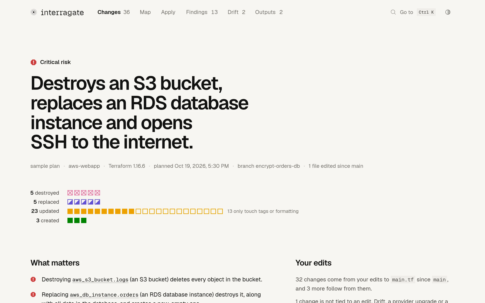
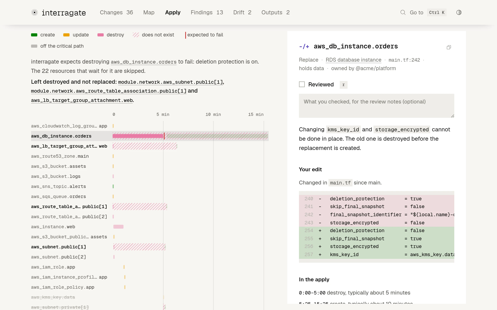
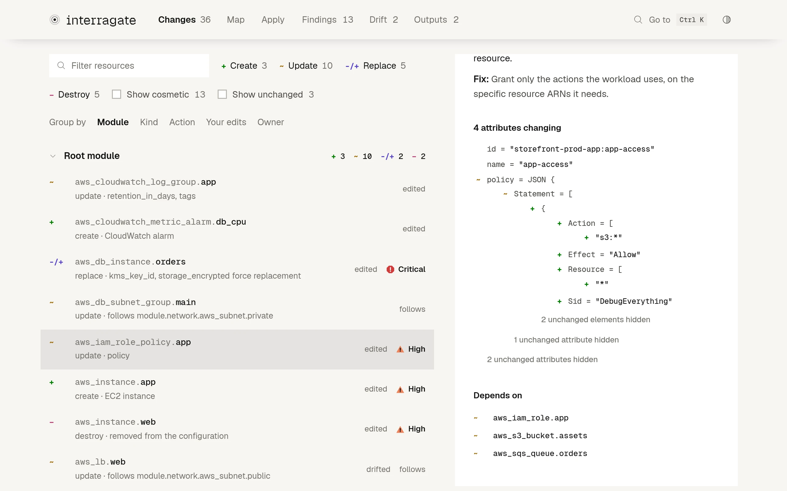

# The interactive report

`interragate report` (or `--open`) writes one self-contained HTML file. It makes no network requests. Review it before sharing: infrastructure details and values not marked sensitive can still appear. See [SECURITY.md](../SECURITY.md).

<picture>
  <source media="(prefers-color-scheme: dark)" srcset="../site/images/overview-dark.webp">
  
</picture>

- **Overview.** The verdict as a headline, then every changed resource drawn as one square, worst first: crossed out when it is destroyed, half filled when it is replaced, hollow when an update only touches tags or formatting. Click a square to open its resource, or a row's label to list only those. Below that: what matters most, the blast radius of the riskiest change, and fixes ready to paste.
- **Terraform's notation.** Actions are marked the way `terraform plan` writes them: `+` create, `~` update, `-/+` replace (`+/-` when the new object is created first), `-` destroy, `<=` read.
- **Map.** Resources laid out by dependency depth in lanes per module (or per kind of resource). Select one to light up everything it depends on and its blast radius, brighter the closer they are. "Around the selection" draws just that chain. Switch the drawing from the plan to **Before** or **After** (or press `b` to flip between them) to see the infrastructure as it is now and as the apply leaves it, in the same layout, with what does not exist at that moment as a dashed outline. Between them, play the apply (`p`): resources light up in their step's colour as interragate's simulation runs them, and come and go as they are created and destroyed. Save the map as an image (PNG, or SVG from Go to) to drop into a pull request: the whole drawing as you see it, with a header saying what it is. A minimap, `f` to fit and `+`/`−` to zoom; zoomed far out it draws blocks only and skips what is off screen, so 2,000-resource plans stay smooth.

  **Fullscreen** expands the map and its details. Press `Esc` to return.

  <picture>
    <source media="(prefers-color-scheme: dark)" srcset="../site/images/map-dark.webp">
    
  </picture>

- **Apply.** How the apply will run, as a timeline with a row per resource: the order Terraform works through the changes in, ten at a time, with typical times for slow resources, the critical path that decides how long it takes, and, for a replacement that destroys first, the window in which the resource does not exist. Select a resource to see what a failure of its step would stop, and what that would leave half done: "If creating `module.network.aws_subnet.private[1]` fails, the 6 resources that wait for it are skipped. Left destroyed and not replaced: `module.network.aws_subnet.private[1]`, `aws_db_instance.orders`…". Each change's detail says when it happens.

  <picture>
    <source media="(prefers-color-scheme: dark)" srcset="../site/images/apply-dark.webp">
    
  </picture>

- **Changes.** Grouped by module, filterable by action, marked with severity and with "follows" and "drifted" where they apply. `j` and `k` step through them, `/` searches.
- **Review.** The changes that need a look (destroys, replacements, findings of medium or worse) form a checklist: `n` jumps to the next one, `r` marks it reviewed, a note records what you checked, and "Copy review notes" gives a Markdown checklist for the pull request or change ticket. Reviews stay in your browser and only stick while a change stays the same.
- **Detail pane.** Why the resource changes, what it follows from and where that starts, your edit behind it, what it deploys or allows, when it happens in the apply, its findings with fixes and copyable snippets, the structured diff with the changed words marked, who owns it, and what it depends on and what uses it.

  <picture>
    <source media="(prefers-color-scheme: dark)" srcset="../site/images/diff-dark.webp">
    
  </picture>

- **Since the last report.** Each report remembers, in your browser, a little about the reports you opened for the same configuration, and leads with what changed since the last one: a pull request's report after new commits, say. Nothing leaves the browser.
- **Go to** (⌘K or Ctrl K): one box that finds any resource, finding, view or command by a few letters of it, from any view, including the map.
- **Sharing.** Copy the pull request comment (the same Markdown as `-f markdown`) from the overview, or save a summary card, an image with the verdict, every changed resource as a square and what matters most, for a chat or a ticket.
- Findings, drift and outputs views, light and dark themes (following the system, or chosen in the toolbar), and deep links (`report.html#r=aws_db_instance.orders`, `#view=map`).

The report is set in [Geist, Geist Mono and Geist Pixel](https://vercel.com/font) (SIL Open Font License 1.1) with [Phosphor](https://phosphoricons.com) icons (MIT). The fonts are subset and embedded, so the file still makes no network requests; the licences are in [`third_party/`](../third_party).
